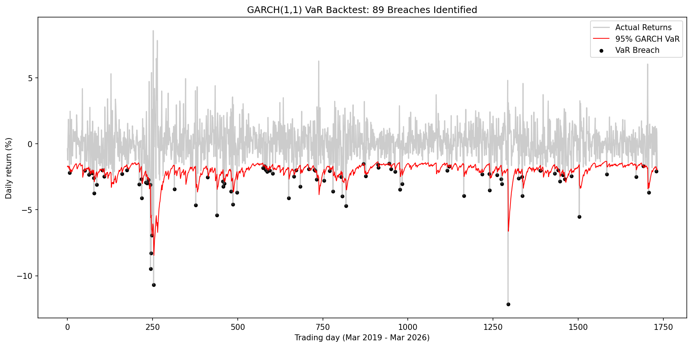
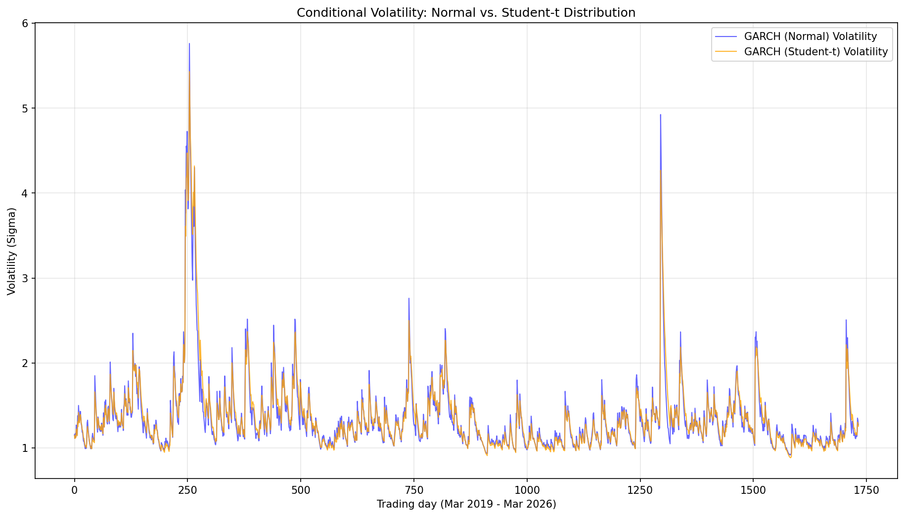

# Portfolio Value at Risk with GARCH(1,1)

**Python · arch · pandas · Excel**

How much could an equity portfolio lose in a single day? This project models the portfolio's changing volatility with **GARCH(1,1)**, estimates a **95% 1-day Value at Risk (VaR)**, and back-tests it over **1,733 trading days**. The model's breach rate came out at **5.14% against the 5% target**, which passes the Kupiec test for correct calibration.



---

## Objective

A single "average" volatility number understates risk in turbulent markets and overstates it in calm ones. Real returns also have **fat tails**: large losses happen more often than a Normal distribution predicts.

This project builds a VaR model that handles both problems:

1. **Volatility clustering:** GARCH(1,1) lets tomorrow's volatility depend on recent shocks and recent volatility.
2. **Fat tails:** a Student's t-distribution in place of the Normal.
3. **Validation:** a back-test that checks how often actual losses exceeded the predicted VaR.

## Data

| | |
|---|---|
| **Portfolio** | Cipla (25 shares), ONGC (150 shares), Bharat Electronics (80 shares): three NSE stocks across pharma, energy and defence |
| **Portfolio value** | ₹1,10,333 at the latest date |
| **Period** | 11 March 2019 to 9 March 2026 (1,734 trading days, 1,733 daily returns) |
| **Returns** | Daily log returns of total portfolio value, calculated in Excel: `LN(Value_t / Value_t-1)` |
| **Benchmark** | Nifty 50 (included in the workbook for reference) |

The workbook `data/VAR Model_Satyadeep.xlsx` holds prices, quantities, position values and portfolio returns. The notebook reads the **Portfolio Returns** column.

## Method

**1. Prepare returns.** Read portfolio returns from Excel, convert them to numbers, put them in chronological order (the sheet lists the newest date first) and scale them to percentages, which helps the optimiser converge.

**2. Fit GARCH(1,1) with Student's t errors.**

σ²ₜ = ω + α·ε²ₜ₋₁ + β·σ²ₜ₋₁

Today's variance is a long-run level (ω), plus a reaction to yesterday's shock (α), plus a carry-over of yesterday's variance (β).

**3. Forecast and calculate VaR.** Forecast next-day mean and volatility, then:

VaR₉₅ = μ + q₀.₀₅ · σₜ₊₁

where q₀.₀₅ is the 5% quantile of the fitted Student's t-distribution (not the Normal 1.645).

**4. Back-test.** For every day in the sample, compare the actual return with that day's VaR threshold and count the breaches (days when the loss was worse than predicted).

**5. Model selection.** Compare GARCH with Normal errors against GARCH with Student's t errors using AIC, BIC and log-likelihood.

---

## Results

### Model parameters (GARCH(1,1), Student's t)

| Parameter | Estimate | Meaning |
|---|---|---|
| μ (mean) | 0.069% | Average daily return |
| α (reaction) | 0.100 | How strongly volatility reacts to a new shock |
| β (persistence) | 0.847 | How much of yesterday's volatility carries into today |
| α + β | 0.947 | High persistence: volatility shocks take about **13 trading days** to halve |
| ν (degrees of freedom) | 5.28 | Low value confirms **fat tails** |

### 95% 1-day Value at Risk

| | |
|---|---|
| Forecast volatility (next day) | 1.34% |
| 95% 1-day VaR | **2.03% of portfolio value, about ₹2,237** |

On 19 trading days out of 20, the portfolio is not expected to lose more than about ₹2,237 in a day.

### Back-test (1,733 days)

| | |
|---|---|
| Expected breaches at 95% | 87 |
| Actual breaches | **89** |
| Breach rate | **5.14%** |
| Kupiec test statistic | 0.07 (pass: critical value at 95% is 3.84) |

The breach rate is very close to the 5% target, and the Kupiec test confirms the difference is not statistically significant: the model is neither under- nor over-estimating risk.

### Normal vs Student's t

| Model | AIC | BIC | Log-likelihood |
|---|---|---|---|
| GARCH (Normal) | 5,859.96 | 5,881.79 | −2,925.98 |
| GARCH (Student's t) | **5,734.67** | **5,761.96** | **−2,862.33** |

The Student's t model wins on every measure (lower AIC and BIC, higher log-likelihood). Both models give similar volatility paths, but the t-distribution captures the size of extreme days better.



The two largest volatility spikes line up with the portfolio's two worst days: **23 March 2020** (COVID crash, −10.7%) and **4 June 2024** (general election result day, −12.2%), when PSU and defence stocks such as ONGC and Bharat Electronics fell sharply.

---

## Limitations and next steps

- **In-sample back-test.** The model's parameters were estimated on the full period and then tested on the same period. A stricter test would re-fit the model on a rolling window and forecast each day using only past data.
- **One confidence level.** Regulators and risk teams also look at 99% VaR and **Expected Shortfall** (the average loss on days beyond VaR), which this project could add.
- **Single-asset view of the portfolio.** The model treats the portfolio as one return series with fixed share quantities. A multivariate model (for example, DCC-GARCH) would capture changing correlations between the three stocks.
- **Symmetric volatility.** GARCH(1,1) treats up and down shocks equally. GJR-GARCH or EGARCH could test whether falls raise volatility more than rises (the leverage effect).

## Repository contents

```
├── README.md
├── requirements.txt
├── notebooks/
│   └── GARCH_VAR.ipynb              # Model, VaR, back-test and model comparison
├── data/
│   └── VAR Model_Satyadeep.xlsx     # Prices, positions and portfolio returns
└── images/
    ├── var_backtest.png
    └── volatility_normal_vs_t.png
```

## How to reproduce

1. Open `notebooks/GARCH_VAR.ipynb` in Google Colab.
2. Upload `data/VAR Model_Satyadeep.xlsx` to Colab's file panel. The notebook expects it in the working folder.
3. Run all cells (**Runtime → Run all**). The first cell installs the `arch` package.

To run locally instead: `pip install -r requirements.txt`, place the workbook next to the notebook, and run it in Jupyter.

---

**Author:** Satyadeep · [LinkedIn](https://www.linkedin.com/in/your-profile) · [Email](mailto:your-email)
